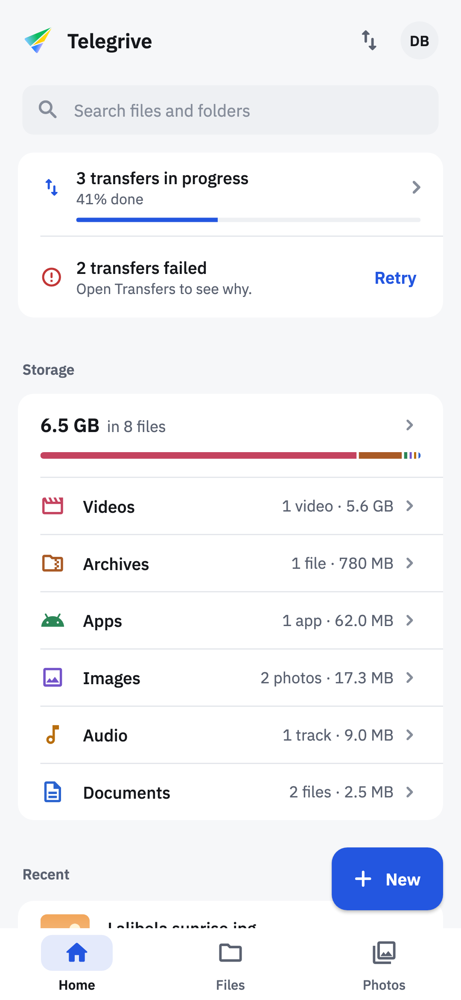
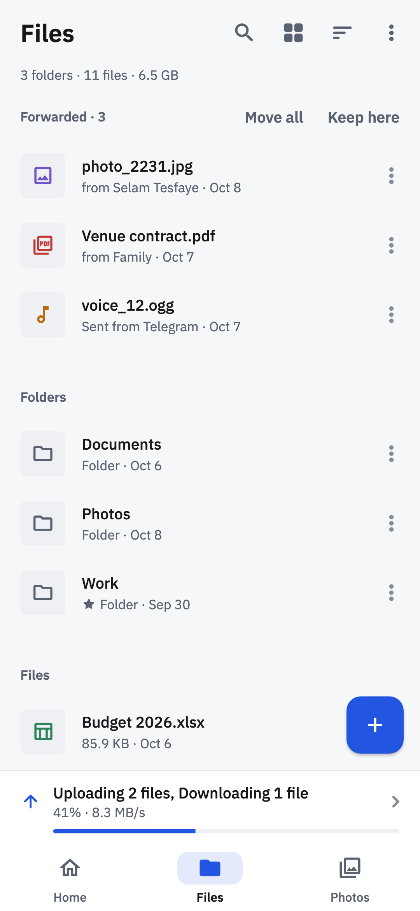
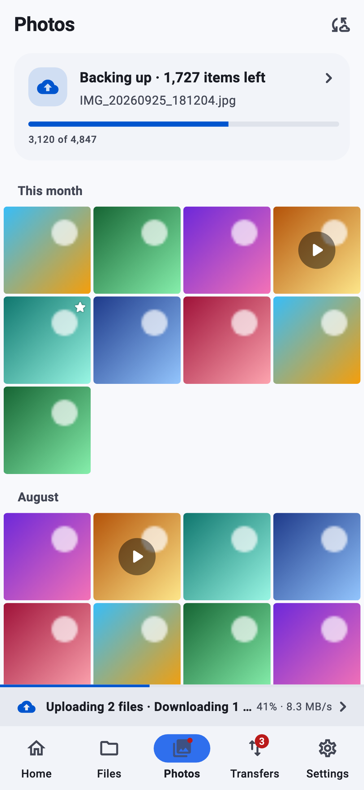
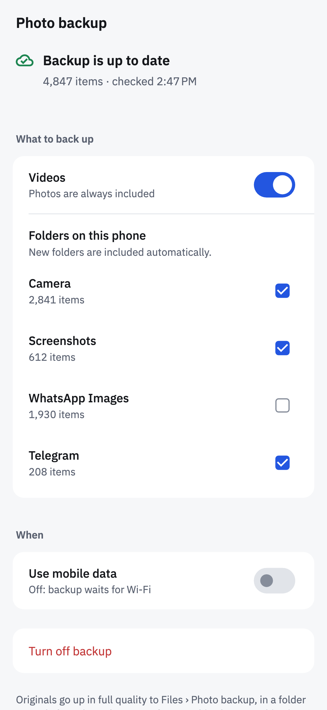

# Telegrive

Your Telegram account as an unlimited drive, with automatic photo backup.
Telegrive stores files in a private Telegram channel on your own account
and gives you a proper file manager on top: folders, search, previews,
stars, a photo timeline, and uploads of any size. There is no Telegrive
server and no account to create — people just sign in with their Telegram
phone number.

<p>




</p>

## Features

- **Unlimited storage.** Every file is a message in a private channel that
  Telegrive creates (or finds again) on your account.
- **Any size.** Telegram caps a message at 2000 MiB (4000 MiB with Premium).
  Bigger files are split into 512 MiB parts and joined back on download.
- **Photo backup.** Turn it on once and the whole camera
  roll goes up in full quality — then every new photo and video follows on
  its own. Choose device folders, videos on or off, Wi-Fi only or mobile
  data. A Photos tab shows your photos and videos as a timeline grouped by
  month, with a swipeable full-screen viewer. Screenshots and chat folders
  back up too, but the timeline leaves them out until you tap Show.
  Long-press and drag to select a run of photos, pinch to change the grid,
  and keep albums (a photo can be in several without being copied), plus
  Favorites and Videos. Home opens with one line that says whether
  everything is backed up and in sync, and when that was last checked.
- **Free up space.** Delete the phone's copies of photos and videos that are
  safely backed up; they stay in the drive.
- **Real folders.** Create, rename, move and delete folders; breadcrumbs;
  list and grid views; sort by name, date, size or type.
- **Recent, as you use it.** Home lists the files you last opened, shared
  or sent on this phone together with the ones you added, each saying which
  and when. Backed-up photos stay in Photos, so a batch of them never
  pushes the rest out. See all splits the list into Opened and Added.
- **Fast and offline-friendly.** A local index (SQLite) makes browsing and
  search instant; the channel stays the source of truth.
- **Syncs itself.** New, edited or deleted messages flow in live. Anything you
  **forward into the channel from Telegram** (documents, videos, audio, voice
  messages, photos) shows up in the drive with no re-upload.
- **Rebuildable.** Names, folders, stars, albums and the trash live in each
  message's caption. Reinstall, sign in on another phone, or sign out and
  back in, and the whole drive comes back. Signing out takes the drive off
  this phone, files kept offline included, and drops any delete still
  waiting out its Undo, so nothing is deleted after you have left.
- **Trash.** Deleting moves things to the trash for 30 days; restore or
  delete for good from Trash. Moving more than 100 items there asks first.
  Photos and videos this phone still has can leave the phone too: tick
  "Also delete from this phone" and, once Undo has had its time without
  being tapped, Android asks to delete them (if you have left the app by
  then, it asks when you are back). Undo, or restoring them from Trash
  before then, leaves the phone's copies untouched, and the box remembers
  your last answer.
- **Undo for every change.** Moving, renaming, starring, adding to or
  removing from an album, restoring and moving to the trash all offer Undo
  for six seconds (with TalkBack on, until you dismiss it), and an Undo
  that can't go through says why. Delete for good, Empty trash and Delete
  album take the items away at once but wait ten seconds, with Undo, before
  anything leaves Telegram; sending the app to the background deletes them
  straight away.
- **Tidy in Telegram too.** Captions lead with the plain file name; the
  machine-readable part sits in a spoiler, so the channel still reads like a
  file list.
- **Transfers that survive.** A queue with live speed and ETA, cancel and
  retry. A failed transfer says why in one sentence, and Home and Transfers
  retry it in place. On Android a foreground service keeps uploads going in
  the background, and interrupted split uploads resume at the last finished
  part.
- **Patient with Telegram.** When Telegram asks for a pause, transfers count
  down and carry on by themselves; when it asks an upload, the other
  uploads hold off too, a split one before its next part, rather than send
  their bytes only to be turned away. Moving, starring, trashing or adding
  many items to an album shows its progress above the bar, or at the foot
  of a screen opened over it, with Stop, and waits out Telegram the same
  way.
- **Watch and read without downloading.** Videos, music, call recordings
  and audiobooks stream as they play, with seeking, even across a split
  file's parts. PDFs and text files open in the app. Everything else opens
  in the right app on your phone.
- **Search inside documents.** The words in PDFs and text files are read on
  the phone, so search finds documents by what they say. Dates work too:
  "march 2024", "last week".
- **Send in Telegram.** Send any file to a chat straight from the drive,
  with no re-upload.
- **Share to Telegrive** from any app on Android, into the folder you pick.
- **Download to this phone.** Files, folders or the whole drive, in the
  drive's folders under Download › Telegrive; photos and videos can go back
  into the gallery.
- **Available offline.** Keep files or folders on the phone to open without
  a connection; new files in a kept folder follow on their own.
- **App lock** with the phone's fingerprint, face or screen lock.
- **Private by default.** API credentials and the local-database key live in
  the platform keystore. TDLib's cache is encrypted from the first launch.
  Telegrive never shows you as "online" to your contacts.

## Getting started

1. The app's Telegram API credentials live in the git-ignored
   `lib/core/config/telegram_api.dart`. On a fresh clone, copy the template
   and fill in an `api_id` / `api_hash` from
   [my.telegram.org](https://my.telegram.org/apps) → API development tools:

   ```bash
   cp lib/core/config/telegram_api.example.dart lib/core/config/telegram_api.dart
   ```

2. Run it on an Android device or emulator:

   ```bash
   flutter pub get
   flutter run
   ```

3. Sign in with your phone number (or a QR code from another device). The
   first time, Telegrive creates a private channel called **Telegrive** with
   the app icon as its photo (archived in Telegram so it stays out of your
   chat list) and offers to back up your photos.

## Platform support

| Platform | Status |
| --- | --- |
| Android (arm64, armv7, x86, x86_64) | ✅ |
| iOS / macOS | Not yet. The UI is ready, but the TDLib binding (`handy_tdlib`) ships Android binaries only. See the roadmap. |

## Photo backup

- **Scope.** Every photo (and, optionally, video) on the phone, minus any
  device folders you switch off. Folders that appear later are included.
- **Where it goes.** `My Drive › Photo backup › <device folder>`, originals
  in full quality with their capture date and GPS data intact, plus a
  preview thumbnail so videos have posters too.
- **Out of the way.** Screenshots and chat folders back up too but stay out
  of the Photos view unless you show them; change this per folder in Backup
  settings.
- **Exactly once.** Each photo's device id is remembered, and anything
  already in the drive with the same name and size (after a reinstall, or
  from an old phone) is recognised and skipped.
- **Keeps going.** A pass runs when the drive opens, when the app comes back
  to the foreground, and whenever the photo library changes while the app is
  alive; a foreground service keeps it running in the background.
- **When the app is closed**, Android wakes a tiny job the moment new photos
  land (a MediaStore content trigger) and every few hours as a fallback. It
  posts "N new photos to back up"; tapping it opens the app, which backs
  them up.

## How it works

```text
Telegram (source of truth)                 This device
┌──────────────────────────────┐    sync    ┌─────────────────────────────┐
│ private channel "Telegrive"   │ ─────────▶ │ index (Drift/SQLite)        │
│  • file message              │  live +    │  folders · files · parts    │
│    caption: name + gr1:{…}   │  catch-up  │                             │
│  • folder message            │ ◀───────── │ transfer queue (persisted)  │
│    text: 📁 name + grf1:{…}  │  changes   │  uploads · downloads         │
└──────────────────────────────┘            └─────────────────────────────┘
```

- **Files** carry a manifest in their caption: id, name, folder, MIME type,
  size, dates, star, and `partIndex`/`partCount` for split files.
- **Folders** are small text messages carrying their own id, name and parent,
  so renames and moves are a single edit and two devices never overwrite each
  other's folder tree.
- **Newer versions can add to a manifest.** Keys this install doesn't know
  are kept in the index and written back on its own edits, so a rename or
  move made here doesn't lose what a newer version stored.
- **Changes go to Telegram first.** The index is written from the message
  Telegram sends back, so it never claims something the channel doesn't have.
- **Sync** runs live while the app is open, catches up incrementally on launch
  and on pull-to-refresh, and does a full reconciliation daily, once on the
  first launch after an update that changes how messages are indexed, and
  from Settings → Rebuild index.

## Project layout

```text
lib/
├── app/               # app root, router (phase-driven), shell, theme
├── core/              # config, formatting, file kinds, shared widgets
├── infrastructure/
│   ├── telegram/      # TDLib client, background receiver, secure storage
│   ├── database/      # Drift schema and queries (the local index)
│   └── storage/       # small preferences
└── features/
    ├── auth/          # welcome, credentials, phone/code/password/QR
    ├── setup/         # splash, find-or-create (and brand) the drive channel
    ├── drive/         # manifest format, indexer, repository, sync
    ├── transfers/     # upload/download queue, background keep-alive
    ├── backup/        # photo backup: controller, worker, notification, UI
    ├── files/ home/ photos/ search/ settings/ viewer/
```

Riverpod 3 for state, go_router for navigation (sign-in screens follow the
TDLib authorization state instead of being pushed by hand), and Drift for the
index. TDLib types stay inside `infrastructure/` and `features/*/data`.

## Development

```bash
flutter test                                              # unit + DB tests
dart run build_runner build                               # after schema changes
flutter test tool/screenshots/screens_test.dart --update-goldens  # UI renders with sample data
flutter test tool/icon/icon_test.dart --update-goldens && dart run flutter_launcher_icons
```

The screenshot harness renders the signed-in screens with fake data, so UI
work doesn't need a Telegram account.

A schema version bump also dumps the new schema into `drift_schemas/` and
regenerates the helpers `test/migration_test.dart` checks upgrades with; the
two commands are at the top of that test.

## Roadmap

- **Newer TDLib and 16 KB page support.** `handy_tdlib` bundles TDLib 1.8.36,
  and its binaries aren't 16 KB-page aligned. Android 15+ devices with 16 KB
  pages run the app in compatibility mode, and Play Store uploads need
  alignment. The plan is to vendor current `libtdjson` builds.
- **iOS and macOS**, using prebuilt TDLib xcframeworks through the same FFI
  binding.
- **End-to-end encryption** of file bodies and captions with a recovery
  passphrase.
- **Fully unattended background backup** with the app closed. Today the
  closed-app job notifies and the app does the upload; running TDLib inside
  the background job would remove that tap.
- **Share-sheet intake on iOS**, which needs a share extension.

## Good to know

- Keep the **Telegrive** channel. Deleting it deletes your drive. Deleting or
  editing its messages in Telegram changes the drive accordingly.
- Split files appear in Telegram as numbered parts (`movie.mkv.001`, …). Only
  Telegrive joins them back.
- Forwarded files land at the root; move them into folders from the app.
- When Telegram asks for a pause longer than five minutes, Telegrive lets the
  phone sleep rather than keep it awake, so a transfer may wait until you next
  open the app.

Telegrive is an independent project, not affiliated with Telegram.
